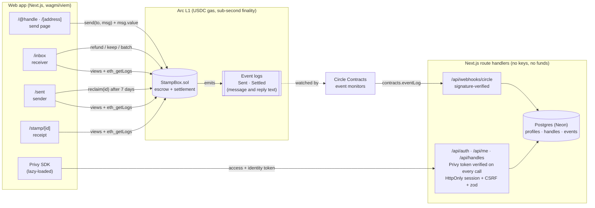
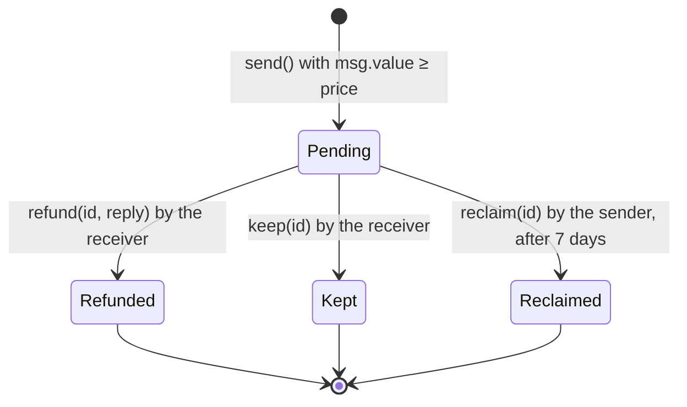

<div align="center">

# Stamp

**A refundable paid inbox on Arc.**

Strangers attach a small USDC stamp to message you. Reply and they get it back. Mark it as spam and you keep it.

[](https://github.com/SuryaXyz-art/stamp/actions/workflows/ci.yml)


[StampBox on Arc Testnet](https://explorer.testnet.arc.io/address/0x448C8cAB90a6aaCa0692cEBCDDCD06D3cA15d24B) · [Deploy guide](docs/DEPLOYMENT.md) · [Security](SECURITY.md)

</div>

---

## Contents

- [The idea](#the-idea)
- [How it works](#how-it-works)
- [Why Arc](#why-arc)
- [For developers and AI agents](#for-developers-and-ai-agents)
- [Architecture](#architecture)
- [Security model](#security-model)
- [Run it locally](#run-it-locally)
- [Tests](#tests)
- [Deploying your own](#deploying-your-own)
- [FAQ](#faq)
- [Troubleshooting](#troubleshooting)
- [Roadmap](#roadmap)
- [Project structure](#project-structure)

## The idea

My DMs are mostly cold pitches, and more and more of them are written by bots. Filters keep losing that fight because sending a message costs nothing.

Stamp puts a price on attention instead. To reach you, a stranger puts down a small deposit in USDC, at a price you choose. What happens to it depends on what you do:

- **You reply.** The stamp goes straight back to the sender in the same transaction, so a genuine message costs them nothing.
- **You mark it as spam.** You keep the stamp, so the spammer has paid you for your time.
- **You ignore it.** After 7 days the sender can take the stamp back themselves, so nobody's money gets stuck.

## How it works

1. **Open an inbox.** Pick a price (for example $1) and an optional one-line headline. You get a link like `/@alice` or `/0x…` to share.
2. **Someone sends a stamp.** They write a message and pay the stamp in one transaction. On Arc it lands in under a second.
3. **You triage.** Reply, keep or ignore each message from your inbox. There are keyboard shortcuts and batch actions for clearing a backlog.
4. **Everyone gets a receipt.** Each stamp has a public page at `/stamp/<id>` that links to its transactions on the Arc explorer.

You can sign in with a wallet, or with X, Discord, Google, email or a passkey through Privy, which creates a self-custodial wallet for you. Accounts are optional, and the app works as a plain wallet client without them.

## Why Arc

Stamp only makes sense because of how Arc works:

| Arc feature | What it means for a $1 stamp |
|---|---|
| **USDC is the gas token** | A sender needs one asset, dollars. There's no second token to buy first. |
| **Fees are tiny and priced in dollars** | On most chains the gas would cost more than the stamp. On Arc, a $0.25 stamp still makes sense. |
| **Sub-second, deterministic finality** | Sending a stamp feels like sending a DM. One confirmation is final, so the UI can say *Delivered* right away. |
| **Native USDC through `msg.value`** | The stamp travels with the call itself. There's no `approve` step and no allowance to manage. |

> **A note on decimals:** Arc's native USDC, used for gas and `msg.value`, has **18 decimals**. Arc also exposes a 6-decimal ERC-20 view of USDC. Stamp only uses the native balance, so `parseEther("1")` is exactly $1.00.

## For developers and AI agents

Stamp also gives automated outreach a fair way to reach people: an agent puts down a refundable deposit instead of spamming for free. There's no API key, and the server never signs or holds anything.

```bash
curl "https://<your-site>/api/v1/stamp?to=@alice&message=Hi%20Alice"
```

The response includes the recipient, their live price, the rules, and a ready-to-sign transaction (`{ chainId, to, value, data }`) that any wallet or agent can send.

| Endpoint | What it does |
|---|---|
| `GET /api/v1/stamp` | Public and CORS-enabled. Resolves an address or `@handle`, returns the inbox price and, if you pass `message`, the `send()` transaction. |
| `GET /badge/<address or handle>` | An SVG "Message me" badge showing your live price, for READMEs, websites and email signatures. Add `?theme=light` for light backgrounds. |

The `/developers` page in the app has a full guide, including an example agent written with viem.

## Architecture

The contract is the product. Every stamp, payment and settlement lives on Arc, and the server never holds funds, keys or message text. A small Next.js backend adds optional extras on top: sign-in, `/@handle` profiles and settings.



### Lifecycle of a stamp



### Design notes

- **Storage holds only what settlement needs:** `from`, `to`, `amount`, `sentAt` and `status` (three storage slots), plus per-user indexes of stamp ids.
- **Message and reply text live only in event logs**, which keeps sending cheap. The app reads ids and status from view functions, then fetches the text with `eth_getLogs` filtered by the indexed `id`. It scans in chunks, halves a chunk when the RPC rejects the range, and starts near the block where the stamp was sent instead of scanning from genesis.
- **Live stats** on the landing page come from four lifetime counters in the contract (`totalSent`, `totalRefunded`, `totalKept`, `totalReclaimed`). They're served through `/api/chain/stats`, so the landing page doesn't load any wallet code.
- **Accounts are optional,** and each feature hides itself when its keys are missing. Privy tokens are verified locally on every request. Our session cookie is HttpOnly and SameSite=Lax, and every write needs a matching CSRF token and a same-origin `Origin` header. Handles are bound to a wallet by an EIP-191 signature that anyone can re-check. We don't store emails or OAuth tokens. See [PRIVACY.md](PRIVACY.md).
- **Circle Contracts and webhooks:** StampBox is imported into Circle's Developer Console with event monitors on `Sent` and `Settled`. Circle posts each event to `/api/webhooks/circle`. The app verifies Circle's ECDSA signature, stores only public event data, and shows the result as **Latest on Arc** on the landing page.
- **Keeping it fast:** wallet and auth code loads as a separate chunk, only on pages that need a wallet. The landing page scores 91+ on Lighthouse mobile.

## Security model

**Non-custodial and immutable, with no admin keys.**

- There's no owner, no admin function, no fee, no pause switch and no proxy. Nobody, including me, can move funds outside the rules below.
- The contract's balance always equals the sum of pending stamps plus deferred payouts (`totalOwed`). This is checked by fuzzed invariant tests.
- Only the **receiver** can `refund` or `keep` a stamp. Only the **sender** can `reclaim` it, and only after 7 days while it's still pending. Every stamp settles exactly once.
- Every payout follows checks-effects-interactions and sits behind OpenZeppelin's `ReentrancyGuard`. The tests include hostile sender and receiver contracts that try to re-enter and fail.
- Every failure has a named custom error: `InboxClosed`, `StampTooSmall`, `NotReceiver`, `NotSender`, `TooEarly`, `AlreadySettled`, `MessageTooLong`, `NothingOwed` and more.
- **Overpaying is safe.** If `msg.value` is above the price, the whole amount becomes the stamp and is refunded or kept in full.
- **Price changes don't touch old stamps.** Each stamp records its own amount.
- **A sender who can't receive USDC never blocks settlement.** Refunds and reclaims are sent with a capped gas allowance and without copying return data. If that payment fails (for example a contract without `receive()`, a blocklisted address or a fallback that burns gas), the stamp still settles and the amount is credited to `owed[sender]`. The sender collects it later with `withdraw()`, or with `withdrawTo(addr)` if their address can't receive at all.

### Limitations

- **Messages are public.** Everything you write is visible on-chain forever, so don't put secrets in a message. Encrypted messages are on the roadmap.
- Stamps make spam expensive, not impossible. Someone willing to pay can still reach you, and you keep their money.
- Messages are capped at 1,000 bytes on-chain. An emoji counts as 4 bytes.

## Run it locally

You need Node 20.9 or newer, pnpm (`npm i -g pnpm`) and [Foundry](https://getfoundry.sh) for the contracts.

```bash
git clone --recurse-submodules https://github.com/SuryaXyz-art/stamp && cd stamp
pnpm install
pnpm dev            # http://localhost:3000
```

You don't need a `.env` file. By default the app uses Arc's public RPCs and the contract addresses in `contracts/deployments/`, and sign-in falls back to browser wallets. To turn on accounts, copy [`web/.env.example`](web/.env.example) to `web/.env.local` and fill in the Privy keys, a `SESSION_SECRET` and a `DATABASE_URL`. For local work, `DATABASE_URL=pglite:./.data/pglite` runs Postgres in-process with nothing to install.

| Command | What it does |
|---|---|
| `pnpm dev` | Starts the Next.js dev server |
| `pnpm test` | Runs `forge test`, the web unit tests (Vitest), the type check and lint |
| `pnpm build` | Runs `forge build` and `next build` |
| `pnpm abi` | Re-exports the ABI and deployment addresses into the web app after a contract change or deploy |
| `pnpm launch check` | Shows what's configured for a mainnet launch and what's still missing |

## Tests

```bash
cd contracts
forge test -vv                                   # 70 tests: unit, fuzz, reentrancy, payout failures, invariants
forge coverage --no-match-coverage "test/"       # 100% lines, statements, branches and functions
forge snapshot                                   # gas snapshot in .gas-snapshot
```

| File | Lines | Statements | Branches | Functions |
|---|---|---|---|---|
| `src/StampBox.sol` | 100% (113/113) | 100% (124/124) | 100% (22/22) | 100% (25/25) |

Median gas: `send` 188k · `refund` 74k · `keep` 68k · `reclaim` 68k · `withdraw` 29k · `openInbox` 70k.

On the web side, Vitest covers the API routes (against an in-process Postgres), Privy token checks, CSRF, handle signatures, the Circle webhook signature, the public agent API, the CSP builder, money formatting and WCAG contrast for both themes.

## Deploying your own

Copy `.env.example` to `.env` in the repo root, fill it in, and run `pnpm launch check`. It walks you through `deploy`, `env`, `db` and `circle`. The full guide is in [docs/DEPLOYMENT.md](docs/DEPLOYMENT.md).

If you'd rather do it by hand with an encrypted keystore:

```bash
cast wallet import stamp-deployer --interactive
cd contracts
forge script script/Deploy.s.sol --rpc-url arc_testnet --account stamp-deployer --broadcast \
  --verify --verifier blockscout --verifier-url https://explorer.testnet.arc.io/api/
pnpm record testnet     # writes deployments/arc-testnet.json and regenerates the web artifacts
```

For mainnet, use `--rpc-url arc_mainnet`, `--verifier-url https://explorer.arc.io/api/` and `pnpm record mainnet`. Once `deployments/arc-mainnet.json` exists, the app opens on mainnet by default.

## FAQ

**Do I need ETH or another token?**
No. Arc uses USDC for gas, so USDC is all you need.

**Where is my money while a message is pending?**
In the StampBox contract, not with the receiver. It can only leave through a refund, a keep or a reclaim.

**What if the receiver never answers?**
After 7 days you can reclaim the stamp from your **Sent** page. Until you do, the receiver can still reply or keep it.

**Can the receiver change the price after I've sent?**
Yes, but your stamp keeps the amount you sent.

**Is there a fee?**
No. Stamp takes nothing. You only pay Arc's network fee, which is a fraction of a cent.

**Can AI agents use this?**
Yes. `GET /api/v1/stamp?to=@handle&message=…` returns a ready-to-sign transaction, and anything that can sign an Arc transaction can send it. See `/developers` in the app.

## Troubleshooting

| Problem | Fix |
|---|---|
| **"Wrong network" banner** | Click **Switch to Arc**. If your wallet doesn't know Arc yet, use **Add Arc to wallet** in the footer. It adds the chain (ID `5042` for mainnet, `5042002` for testnet) in one click. |
| **"Not enough USDC"** | You need the stamp amount plus a tiny fee. On testnet, get USDC from [faucet.circle.com](https://faucet.circle.com). On mainnet, bridge or withdraw USDC to Arc. |
| **"This inbox is closed"** | The receiver isn't accepting new stamps right now. You weren't charged. |
| **Messages keep showing a loading shimmer** | The public RPC may be rate-limiting `eth_getLogs`. Set `NEXT_PUBLIC_ARC_TESTNET_RPC` or `NEXT_PUBLIC_ARC_MAINNET_RPC` to a provider endpoint. |
| **No wallets in the connect dialog on mobile** | Set `NEXT_PUBLIC_WALLETCONNECT_PROJECT_ID` to turn on WalletConnect for mobile wallets. |

**On Windows**

- Use Git Bash or WSL for Foundry. `foundryup` installs to `~/.foundry/bin`, so add that to your `PATH`.
- Clone with `--recurse-submodules`, or run `git submodule update --init --recursive`. Otherwise `forge build` can't find OpenZeppelin.
- The repo enforces LF line endings through `.gitattributes`, so `forge fmt --check` gives the same result locally as in CI.

## Roadmap

- **Encrypted messages**, so only the receiver can read them.
- **An allowlist or free tier** for followers, contacts and people you've already replied to.
- **An agent SDK with an HTTP 402 flow**, built on today's quote API, so an agent can ask the price and pay in one round trip.
- **Cross-chain funding** with Circle's Bridge Kit (CCTP), so senders can pay from any chain.
- **Notifications** by email, Telegram and push when a stamped message arrives.

## Project structure

```
stamp/
├── contracts/            Foundry project
│   ├── src/              StampBox.sol
│   ├── test/             unit, fuzz, invariant, reentrancy and payout tests
│   ├── script/           deploy script
│   ├── scripts/          ABI export and deployment recording
│   └── deployments/      deployed addresses per network
├── web/                  Next.js 16 app (App Router, Tailwind 4, shadcn/ui, wagmi + viem, Privy, Drizzle)
│   ├── src/app/          pages and API routes
│   ├── src/components/   UI, grouped by feature
│   ├── src/lib/          shared logic; server-only code lives in lib/server
│   └── drizzle/          database migrations
├── scripts/launch.mjs    one-command launch helper (pnpm launch …)
├── docs/DEPLOYMENT.md    step-by-step deploy guide
└── .github/              CI, security scans and Dependabot
```

## Contributing

Issues and pull requests are welcome. Read [CONTRIBUTING.md](CONTRIBUTING.md) first, and report security problems privately as described in [SECURITY.md](SECURITY.md).

## License

[MIT](LICENSE)
