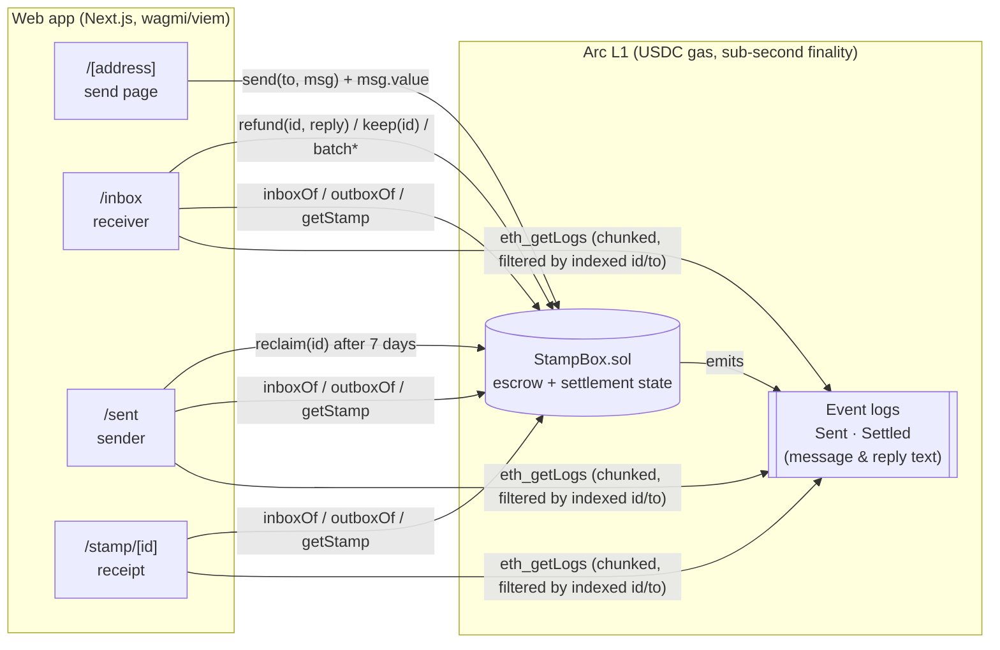
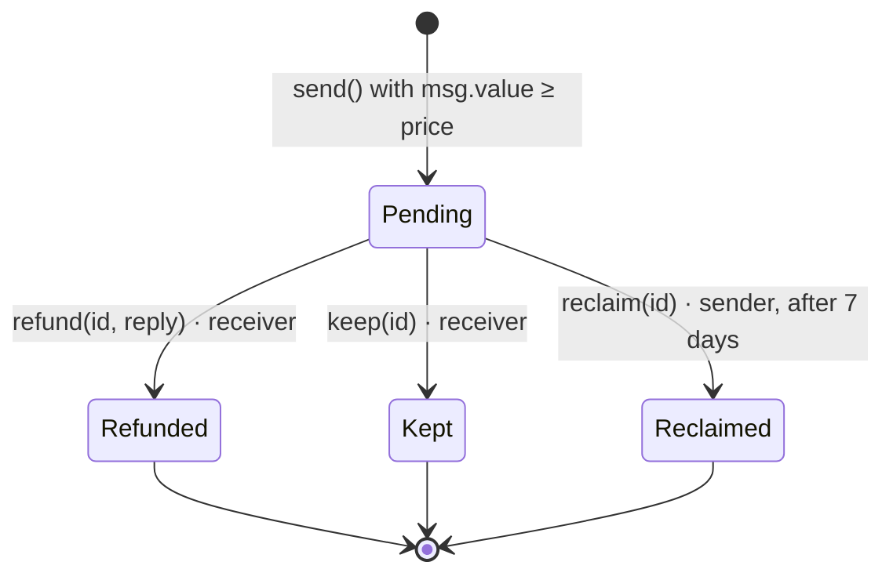

<div align="center">

# Stamp

**A refundable paid inbox on Arc.** Strangers attach a small USDC stamp to message you. Reply and they get it back. Mark it spam and you keep it.

[](https://github.com/ritikpandey/stamp/actions/workflows/ci.yml)


**[Live app →](https://stamp-arc.vercel.app)** · **[StampBox on Arc Testnet](https://explorer.testnet.arc.io)** · [Demo video](#)

<!-- Hero GIF: docs/hero.gif (recorded during launch) -->

</div>

---

## Try it in 30 seconds

1. Open the **[live app](https://stamp-arc.vercel.app)**, then pick **Testnet** in the footer. It's free.
2. Get test USDC from **[Circle's faucet](https://faucet.circle.com)** (choose *Arc Testnet*).
3. Click **Try the demo inbox**, write a message, and hit **Send with $1 stamp**. It's delivered in under a second.
4. When I reply, your $1 comes straight back. Watch it happen on your **Sent** page.

Want your own? **Open my inbox** → pick a price → share your link.

## Why

Cold DMs and AI-agent spam are exploding, and filters keep losing. Stamp prices attention instead: a stranger puts down a small, refundable deposit to reach you.

- **Genuine senders pay nothing.** Reply and the stamp is refunded in the same transaction.
- **Spammers pay you.** Mark a message as spam and you keep the stamp.
- **Nobody can hold it hostage.** If you ignore a message for 7 days, the sender can reclaim the stamp themselves.

## How it uses Arc

Stamp only works because of four things Arc does differently:

| | Why it matters for a $1 stamp |
|---|---|
| **USDC is the gas token** | A sender needs exactly one asset: dollars. No ETH or second token to acquire first. |
| **Tiny, dollar-denominated fees** | On most chains the gas would cost more than the stamp. On Arc a $1 (or $0.25) stamp is economically sane. |
| **Sub-second deterministic finality** | Sending a stamp feels like sending a DM. One confirmation is final, so the UI shows *Delivered ✓* immediately with no confirmation spinners. |
| **Native USDC via `msg.value`** | The stamp rides along with the call. No `approve` + `transferFrom` dance, no allowances. |

> **Decimals:** Arc's native USDC (used for gas and `msg.value`) has **18 decimals**. Arc also exposes a 6-decimal ERC-20 view of USDC. Stamp uses the native balance exclusively: `parseEther("1")` is exactly $1.00, and the app shows one USDC balance.

## Architecture

There is no backend and no database. The contract is the whole product; the web app is a static client that reads and writes Arc directly.



**Lifecycle of a stamp**



- **Storage** holds only what settlement needs: `from`, `to`, `amount`, `sentAt`, `status` (3 slots), plus per-user id indexes.
- **Message and reply text live only in event logs**, which keeps sends cheap. The app reads ids and status from view functions, then fetches text with `eth_getLogs` filtered by indexed `id`. It scans in chunks and halves a chunk if the RPC rejects the range, and it estimates the starting block from `sentAt` to avoid scanning from genesis.
- **Live stats** on the landing page come from four lifetime counters (`totalSent`, `totalRefunded`, `totalKept`, `totalReclaimed`), so no indexer is needed.

## Security model

**Non-custodial, immutable, no admin keys.**

- No owner, no admin functions, no fees, no pause, no upgradeability, no proxy. Nobody, including me, can move funds except through the rules below.
- Funds held by the contract always equal the sum of `Pending` stamps. This is a fuzzed invariant, along with `sent − refunded − kept − reclaimed == balance`.
- Only the **receiver** can `refund` or `keep`. Only the **sender** can `reclaim`, and only after `TIMEOUT` (7 days) while still `Pending`. Every stamp settles exactly once.
- Checks-effects-interactions on every payout, plus OpenZeppelin `ReentrancyGuard`. Tests include malicious receiver and sender contracts that attempt re-entry and are blocked.
- Custom errors for every failure (`InboxClosed`, `StampTooSmall`, `NotReceiver`, `NotSender`, `TooEarly`, `AlreadySettled`, `TransferFailed`, `MessageTooLong`, …).
- **Overpaying:** if `msg.value` exceeds the receiver's price, the whole `msg.value` is the stamp and is refunded or kept in full.
- **Price changes** never affect stamps already sent; each stamp stores its own amount.
- **Batch actions are all-or-nothing.** If one sender in a `batchRefund` can't receive USDC (e.g. a contract without `receive()`, or a Circle-blocklisted address), the batch reverts. Refund the rest individually and `keep` the stuck one.

### Limitations (read these)

- **Messages are public.** Anything you write is visible on-chain forever. Don't include secrets. (Encrypted messages are on the roadmap.)
- Stamps make spam expensive, not impossible. Someone willing to pay can still reach you, and you'll keep their money.
- The 1,000-byte message limit is enforced on-chain, in bytes (an emoji counts as 4).

## Run it locally (3 commands)

Prerequisites: Node ≥ 20.9, pnpm (`npm i -g pnpm`), and [Foundry](https://getfoundry.sh) for the contracts.

```bash
git clone --recurse-submodules https://github.com/ritikpandey/stamp && cd stamp
pnpm install
pnpm dev            # http://localhost:3000, talks to Arc with zero config
```

No `.env` needed: the app defaults to the public Arc RPCs and the deployed contract addresses in `contracts/deployments/*.json`. See [`web/.env.example`](web/.env.example) for optional overrides.

| Command | What it does |
|---|---|
| `pnpm dev` | Next.js dev server |
| `pnpm test` | `forge test` + web typecheck + lint |
| `pnpm build` | `forge build` + `next build` |
| `pnpm abi` | Re-export the ABI and deployment addresses into the web app after a contract change or deploy |

## Tests

```bash
cd contracts
forge test -vv                                   # 57 tests: unit, fuzz, reentrancy, invariants
forge coverage --no-match-coverage "test/"       # 100% lines / statements / branches / functions
forge snapshot                                   # gas snapshot in .gas-snapshot
```

| File | Lines | Statements | Branches | Functions |
|---|---|---|---|---|
| `src/StampBox.sol` | 100% (95/95) | 100% (109/109) | 100% (20/20) | 100% (21/21) |

Gas (median): `send` 188k · `refund` 73k · `keep` 68k · `reclaim` 68k · `openInbox` 70k.

## Deploying your own

```bash
cast wallet import stamp-deployer --interactive        # encrypted keystore, never a raw key in .env
cd contracts
forge script script/Deploy.s.sol --rpc-url arc_testnet --account stamp-deployer --broadcast \
  --verify --verifier blockscout --verifier-url https://explorer.testnet.arc.io/api/
# record address + block in deployments/arc-testnet.json, then:
pnpm abi
```

## FAQ

**Do I need ETH or any other token?** No. Arc uses USDC for gas, so you only need USDC.

**Where is my USDC while a message is pending?** In the StampBox contract, not with the receiver. It leaves only via refund, keep, or reclaim.

**What if the receiver never answers?** After 7 days you can reclaim the stamp from your **Sent** page. The receiver can still reply or keep it until you do.

**Can the receiver change the price after I've sent?** They can, but your stamp keeps the amount you sent.

**Is there a fee?** No. Stamp takes nothing. You only pay Arc's network fee, a fraction of a cent.

**Can AI agents use this?** Yes. Anything that can sign an Arc transaction can send a stamp. An agent SDK is on the roadmap.

## Troubleshooting

| Problem | Fix |
|---|---|
| **"Wrong network" banner** | Click **Switch to Arc**. If your wallet doesn't know Arc yet, use **Add Arc to wallet** in the footer. It adds the chain (ID `5042` mainnet / `5042002` testnet) in one click. |
| **"Not enough USDC"** | You need the stamp amount plus a tiny fee. On testnet, use [faucet.circle.com](https://faucet.circle.com). On mainnet, bridge or withdraw USDC to Arc. |
| **"This inbox is closed"** | The receiver isn't accepting new stamps. Nothing was charged. |
| **Messages show a loading shimmer for a while** | The public RPC may be rate-limiting `eth_getLogs`. Set `NEXT_PUBLIC_ARC_TESTNET_RPC` / `NEXT_PUBLIC_ARC_MAINNET_RPC` to a provider endpoint. |
| **No wallets in the connect dialog on mobile** | Set `NEXT_PUBLIC_WALLETCONNECT_PROJECT_ID` to enable WalletConnect / mobile wallets. |

**Windows notes**

- Use **Git Bash** or **WSL** for Foundry. `foundryup` installs to `~/.foundry/bin`; add it to `PATH`.
- Clone with `--recurse-submodules` (or run `git submodule update --init --recursive`), otherwise `forge build` can't find OpenZeppelin.
- The repo enforces LF line endings via `.gitattributes`, so `forge fmt --check` behaves the same as on CI.

## Roadmap

- **Encrypted messages:** ECIES to the receiver's public key, so only they can read it.
- **Embeddable "Message me with Stamp" button** for sites, READMEs and link-in-bio pages.
- **Allowlist / free tier** for followers, contacts, or past correspondents.
- **AI-agent SDK + HTTP 402-style API** so agents pay to reach humans programmatically.
- **Handles:** ENS-style names instead of `0x…` links.
- **Notifications:** email and Telegram when a stamped message arrives.

## Project structure

```
stamp/
├── contracts/          Foundry: src/StampBox.sol, test/, script/, deployments/
├── web/                Next.js 16 app (App Router, Tailwind 4, shadcn/ui, wagmi + viem, RainbowKit)
├── .github/workflows/  CI: forge fmt/test/coverage/snapshot + web lint/typecheck/build
└── README.md
```

See [CONTRIBUTING.md](CONTRIBUTING.md) to get involved. MIT licensed.
