<div align="center">

<a href="https://stamp-topaz.vercel.app"></a>

<br>

<p><a href="https://stamp-topaz.vercel.app"></a> <a href="https://explorer.arc.io/address/0x654Ac560d556300830CD7B4e0769aC33826556D4?tab=contract"></a> <a href="https://github.com/SuryaXyz-art/stamp/actions/workflows/ci.yml"></a>   </p>

<h3>
  <a href="https://stamp-topaz.vercel.app">🚀 Live app</a>
  &nbsp;·&nbsp;
  <a href="https://stamp-topaz.vercel.app/0x98025B790E3f9F0932D098ADeFA5D9478104CCD2">✉️ Send me a stamp</a>
  &nbsp;·&nbsp;
  <a href="docs/HANDBOOK.md">📖 Project handbook</a>
  &nbsp;·&nbsp;
  <a href="https://explorer.arc.io/address/0x654Ac560d556300830CD7B4e0769aC33826556D4">🔍 Contract on Arc</a>
  &nbsp;·&nbsp;
  <a href="https://stamp-topaz.vercel.app/developers">🤖 Agent API</a>
</h3>

<p><i>The badge below is rendered live by the app. It reads my current price straight from the contract.</i></p>

<a href="https://stamp-topaz.vercel.app/0x98025B790E3f9F0932D098ADeFA5D9478104CCD2"></a>

</div>


## ⚡ Stamp in 30 seconds

My DMs are mostly cold pitches, and more and more of them are written by bots. Filters keep losing that fight because **sending a message costs nothing**. Stamp puts a price on attention instead.

<table>
<tr>
<td width="33%" align="center">
<h3>✉️ They stamp it</h3>
A stranger writes to your link and attaches <b>your price in USDC</b>. The money sits in an immutable contract, not with you and not with us.
</td>
<td width="33%" align="center">
<h3>💬 You reply</h3>
The stamp goes <b>straight back to the sender</b> in the same transaction. A genuine message costs them nothing.
</td>
<td width="33%" align="center">
<h3>🗑️ It's spam</h3>
<b>You keep the stamp.</b> The spammer just paid you for your time. Ignored for 7 days? The sender takes it back.
</td>
</tr>
</table>

<div align="center">
</div>

## 🎬 See it in action

<div align="center">
<a href="https://stamp-topaz.vercel.app">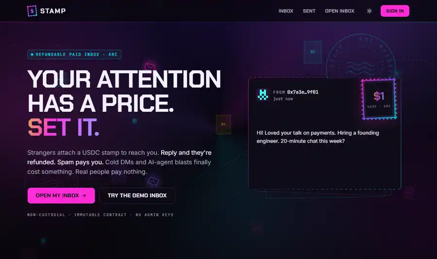</a>
<br>
<sub>Recorded on the live app, <a href="https://stamp-topaz.vercel.app">stamp-topaz.vercel.app</a>: landing page → live mainnet stats → writing to the demo inbox → a real refunded receipt.</sub>
</div>

## ✅ Live on Arc mainnet: proof you can click

Everything below is real and on-chain right now. Nothing is mocked.

| What | Where | What it proves |
|---|---|---|
| 🌐 **Web app** | [stamp-topaz.vercel.app](https://stamp-topaz.vercel.app) | Production deployment on Vercel, wired to Arc mainnet |
| 📜 **StampBox contract** | [`0x654Ac560…6556D4`](https://explorer.arc.io/address/0x654Ac560d556300830CD7B4e0769aC33826556D4?tab=contract) | Source-verified, **exact bytecode match**, Solidity 0.8.30 |
| ✉️ **Demo inbox** | [`0x9802…CCD2`](https://stamp-topaz.vercel.app/0x98025B790E3f9F0932D098ADeFA5D9478104CCD2) | An open inbox at **$0.10** that you can message right now |
| 💚 **A refunded stamp** | [Receipt #0](https://stamp-topaz.vercel.app/stamp/0) | Sender wrote, receiver replied, $0.10 went back in the same transaction |
| 🩷 **A stamp kept as spam** | [Receipt #2](https://stamp-topaz.vercel.app/stamp/2) | The receiver kept the $0.10 |
| ⏳ **A pending stamp** | [Receipt #1](https://stamp-topaz.vercel.app/stamp/1) | Held in escrow, reclaimable by the sender after 7 days |
| 🤖 **Agent quote API** | [`/api/v1/stamp?to=…`](https://stamp-topaz.vercel.app/api/v1/stamp?to=0x98025B790E3f9F0932D098ADeFA5D9478104CCD2&message=hi) | A public, keyless endpoint returning a ready-to-sign transaction |
| 🏷️ **Live badge** | [`/badge/0x9802…`](https://stamp-topaz.vercel.app/badge/0x98025B790E3f9F0932D098ADeFA5D9478104CCD2) | An SVG rendered from on-chain state (it's the badge at the top of this page) |

| Network | StampBox | Start block |
|---|---|---|
| Arc mainnet (`5042`) | [`0x654Ac560d556300830CD7B4e0769aC33826556D4`](https://explorer.arc.io/address/0x654Ac560d556300830CD7B4e0769aC33826556D4) | 25809377 |
| Arc testnet (`5042002`) | [`0x448C8cAB90a6aaCa0692cEBCDDCD06D3cA15d24B`](https://explorer.testnet.arc.io/address/0x448C8cAB90a6aaCa0692cEBCDDCD06D3cA15d24B) | 65630121 |


## 🖼️ A tour of every screen

### 1 · Landing page: the pitch, with live numbers
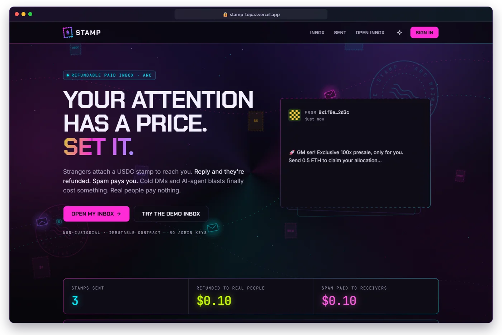

The first screen says what Stamp is in one line: *Your attention has a price. Set it.* Underneath:
- **Open my inbox** starts onboarding. **Try the demo inbox** lets anyone send a real stamp in under a minute.
- An animated **hero demo** shows envelopes arriving, getting stamped *Pending*, then *Refunded* or *Kept*.
- **Live stats** (stamps sent, refunded to real people, spam paid to receivers) come from four lifetime counters inside the contract. They aren't a database guess.
- **Latest on Arc** lists the most recent stamps, read live from the StampBox contract.
- The night-sky backdrop of flying envelopes, postmarks and rising coins is pure CSS/SVG, and it switches off for people who prefer reduced motion.

<table>
<tr>
<td width="50%">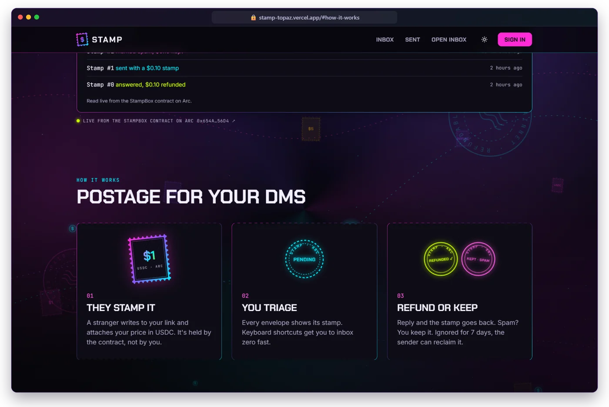</td>
<td width="50%">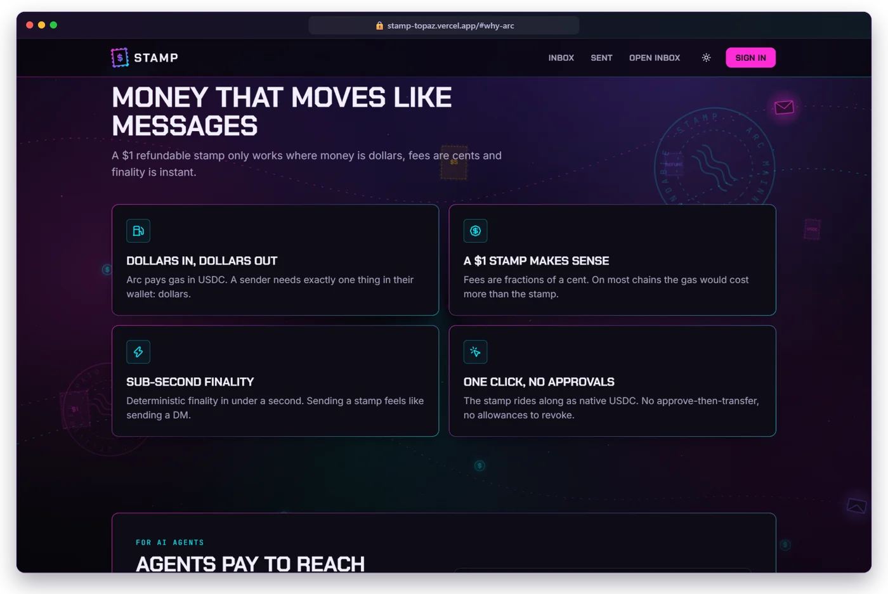</td>
</tr>
<tr>
<td><b>How it works:</b> three steps (they stamp it, you triage, refund or keep), each with its own artwork.</td>
<td><b>Why Arc:</b> dollars in and out, $1 stamps that make sense, sub-second finality, one click with no approvals.</td>
</tr>
</table>

### 2 · Send page: anyone can reach you, for a price you set
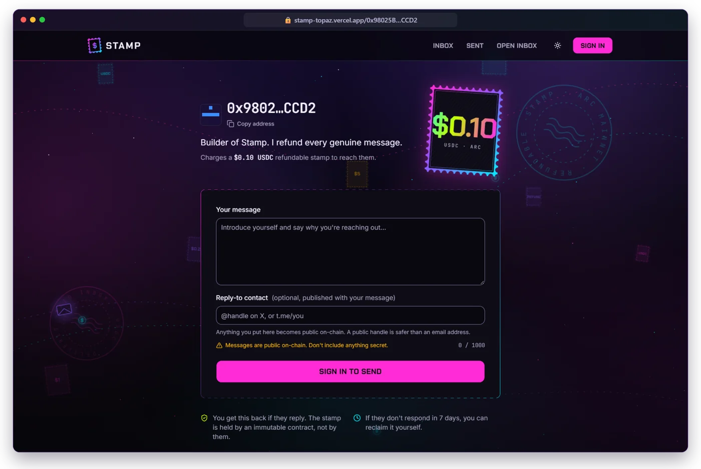

Every inbox has a public link (`/0xaddress` or `/@handle`). The sender sees:

| Field | What it does |
|---|---|
| **Header** | The receiver's identicon, address or handle, their one-line bio and a **Copy address** button |
| **Stamp** | A big animated postage stamp showing the live price, read from `priceOf()` on-chain |
| **Your message** | Up to **1,000 bytes**, with a live counter. An emoji counts as 4 bytes, and the counter knows that |
| **Reply-to contact** | Optional: an X handle or Telegram link, published with the message so the receiver can answer off-chain too |
| **Warnings** | A reminder that messages are public on-chain, so nothing secret should go in them |
| **Send button** | Signs in if needed, switches the wallet to Arc (adding the chain if it's missing), then sends `send(to, message)` with the stamp as `msg.value` |
| **Guarantees** | *You get this back if they reply* · *If they don't respond in 7 days, you can reclaim it yourself* |

### 3 · Inbox: triage at the speed of email
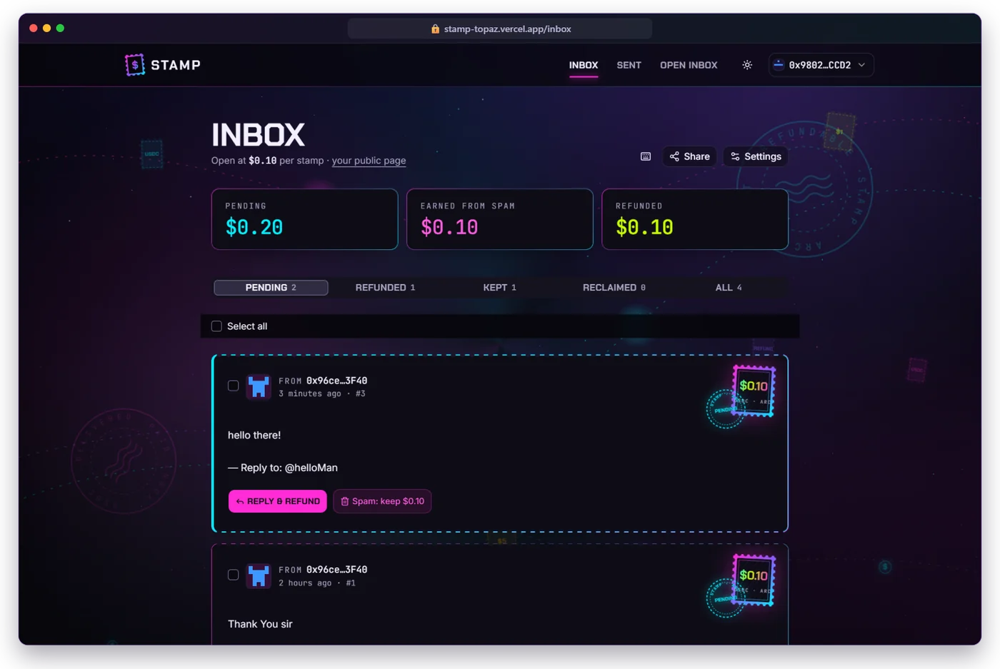

- **Three money cards:** *Pending* (held for you), *Earned from spam* (yours to keep) and *Refunded* (handed back to genuine senders).
- **Tabs** for Pending · Refunded · Kept · Reclaimed · All, with live counts.
- **Envelope cards** show the sender, time, stamp id, the message, any reply-to contact, and a postmark for the stamp's status.
- **Batch actions:** select several stamps and refund or keep them all in one transaction (`batchRefund` / `batchKeep`).
- **Keyboard shortcuts:** `J`/`K` to move, `X` to select, `R` to reply & refund, `S` to mark spam, `Esc` to close, `Ctrl/⌘+Enter` to send a reply, `?` for help.
- **Share** opens your link, a QR code and a "Message me" badge. **Settings** changes your price or bio, or closes the inbox.

### 4 · Reply & refund: one action, two outcomes
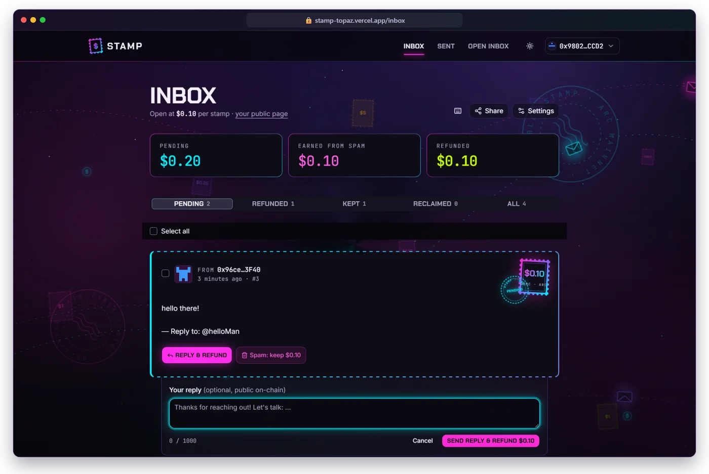

Click **Reply & refund** and a reply box opens under the message. The reply is optional and public on-chain. Pressing **Send reply & refund $0.10** calls `refund(id, reply)`, which records the reply **and** returns the stamp in a single transaction. **Spam: keep $0.10** calls `keep(id)` and the stamp is yours.

### 5 · Sent: the sender's side
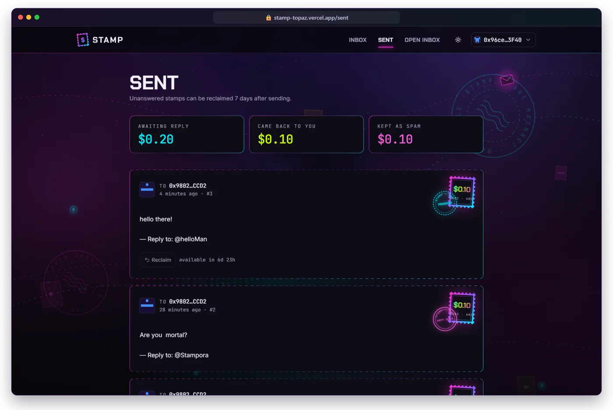

Senders track every stamp they've paid: **Awaiting reply**, **Came back to you** and **Kept as spam**. A pending stamp shows a **Reclaim** button with a countdown (*available in 6d 23h*). After 7 days without an answer, the sender pulls their money back with `reclaim(id)`.

### 6 · Receipts: a public page for every stamp
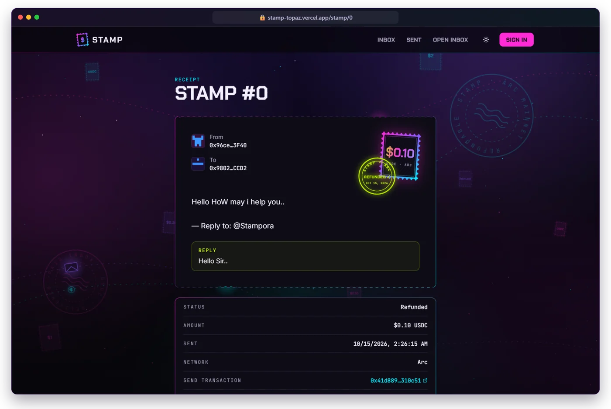

Every stamp has a shareable receipt at `/stamp/<id>`: from, to, the message, the reply, a dated **REFUNDED / KEPT / PENDING** postmark, the amount, the network and links to each transaction on the Arc explorer.

### 7 · Developers & AI agents: pay to reach a human
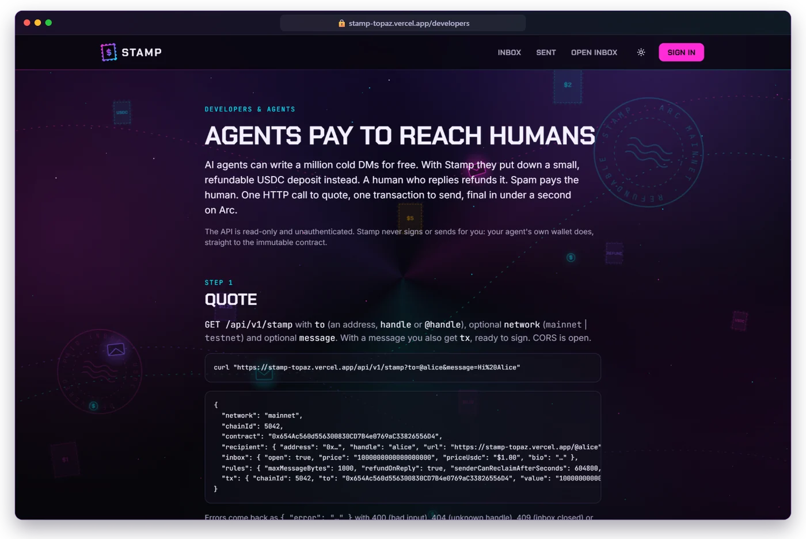

A full guide for bots and agents: **quote** with one HTTP call, **send** with one transaction, **verify** on-chain. It includes response examples, error codes and an example agent written with viem.

### 8 · Mobile-first, with a bottom tab bar
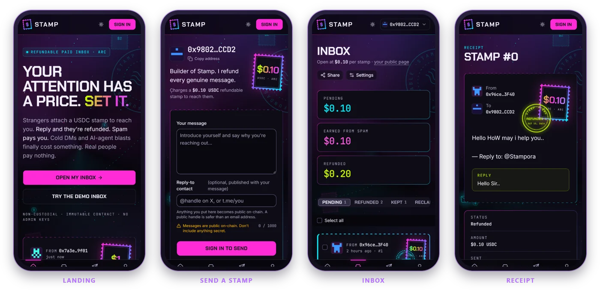

Every screen is designed for a phone first: thumb-reachable navigation (Home · Inbox · Sent · Me), stacked money cards and full-width actions.

### 9 · Light theme, for the daytime crowd
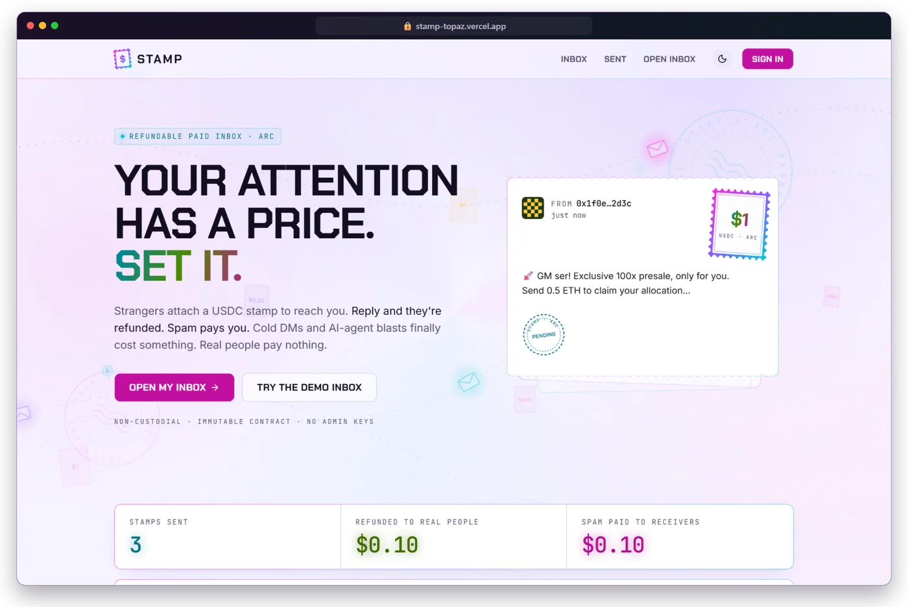

One click on the sun/moon icon switches themes, and the choice is remembered. Both themes are checked for **WCAG contrast** in the unit tests.

### 10 · Verified on the Arc explorer
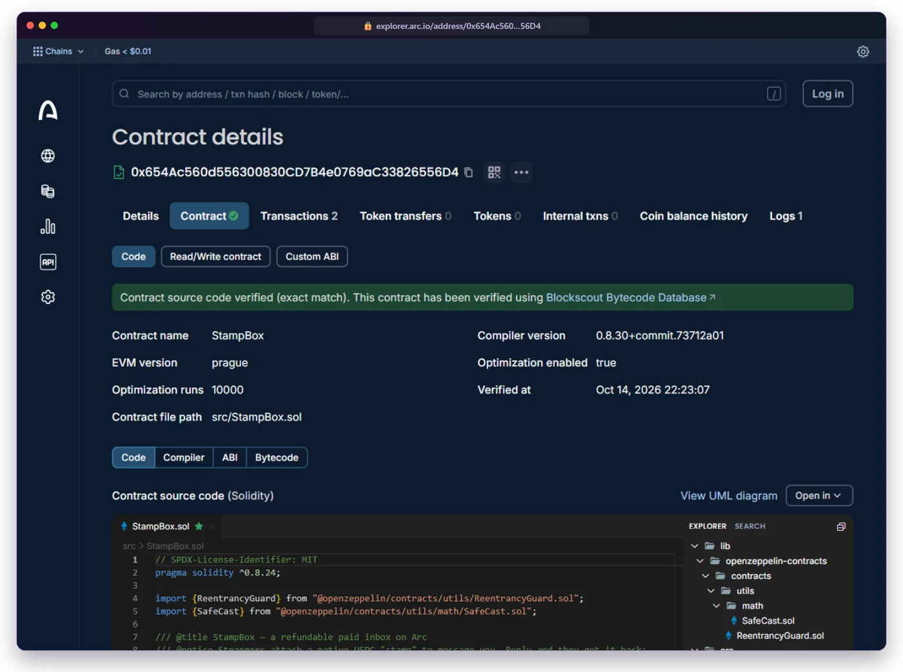

The deployed bytecode is matched to this repo's source (**exact match**, via Sourcify), so anyone can read the exact code that holds the money.


## 🟦 Why Arc

Stamp only makes sense because of how Arc works:

| Arc feature | What it means for a $1 stamp |
|---|---|
| 💵 **USDC is the gas token** | A sender needs one asset, dollars. There's no second token to buy first. |
| 🪙 **Fees are tiny and priced in dollars** | On most chains the gas would cost more than the stamp. On Arc, a $0.25 stamp still makes sense. |
| ⚡ **Sub-second, deterministic finality** | Sending a stamp feels like sending a DM. One confirmation is final, so the UI can say *Delivered* right away. |
| 🎯 **Native USDC through `msg.value`** | The stamp travels with the call itself. There's no `approve` step and no allowance to manage. |

> [!NOTE]
> **A note on decimals:** Arc's native USDC, used for gas and `msg.value`, has **18 decimals**. Arc also exposes a 6-decimal ERC-20 view of USDC. Stamp only uses the native balance, so `parseEther("1")` is exactly $1.00. The app also sends fees above Arc's 20 Gwei mempool floor.

## 🤖 For developers and AI agents

Stamp gives automated outreach a fair way to reach people: an agent puts down a refundable deposit instead of spamming for free. There's no API key, and the server never signs or holds anything.

```bash
curl "https://stamp-topaz.vercel.app/api/v1/stamp?to=0x98025B790E3f9F0932D098ADeFA5D9478104CCD2&message=Hi%20there"
```

The response includes the recipient, their live price, the rules, and a ready-to-sign transaction (`{ chainId, to, value, data }`) that any wallet or agent can send:

```ts
const q = await fetch(`https://stamp-topaz.vercel.app/api/v1/stamp?to=@alice&message=${encodeURIComponent(msg)}`).then((r) => r.json());
await wallet.sendTransaction({ ...q.tx, value: BigInt(q.tx.value) }); // final in under a second on Arc
```

| Endpoint | What it does |
|---|---|
| `GET /api/v1/stamp` | Public and CORS-enabled. Resolves an address or `@handle`, returns the inbox price and, if you pass `message`, the `send()` transaction. |
| `GET /badge/<address or handle>` | An SVG "Message me" badge showing your live price, for READMEs, websites and email signatures. Add `?theme=light` for light backgrounds. |

Want your own badge? Paste this in your GitHub profile README:

```md
[](https://stamp-topaz.vercel.app/<your-address>)
```

The `/developers` page in the app has a full guide, including an example agent written with viem.

## 🏗️ Architecture

The contract is the product. Every stamp, payment and settlement lives on Arc, and the server never holds funds, keys or message text. A small Next.js backend adds optional extras on top: sign-in, `/@handle` profiles and settings.

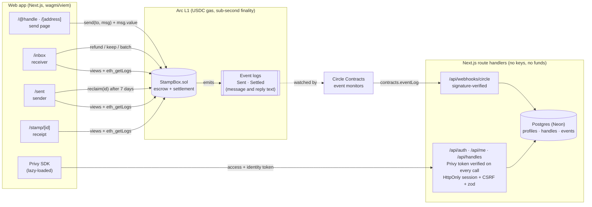

### Lifecycle of a stamp

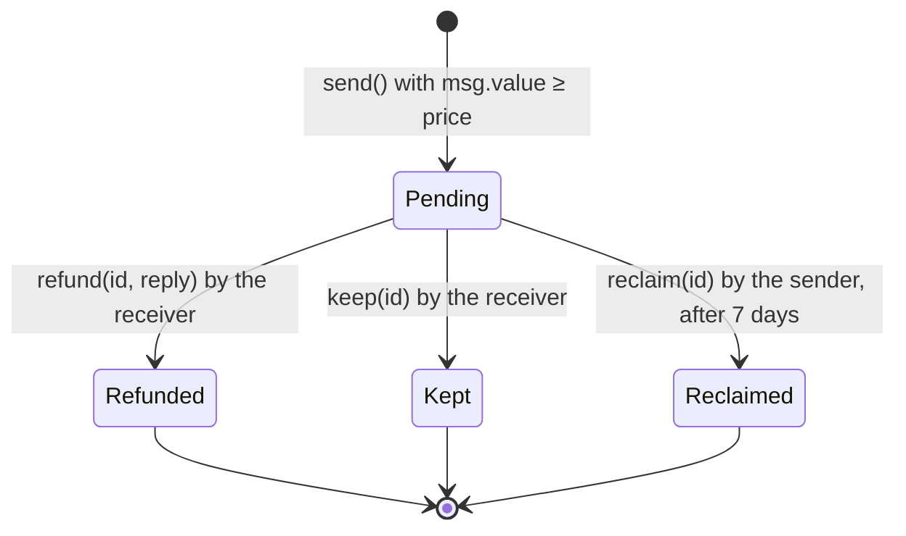

<details>
<summary><b>🔧 Design notes</b> (storage, logs, stats, accounts, Circle, performance)</summary>

<br>

- **Storage holds only what settlement needs:** `from`, `to`, `amount`, `sentAt` and `status` (three storage slots), plus per-user indexes of stamp ids.
- **Message and reply text live only in event logs**, which keeps sending cheap. The app reads ids and status from view functions, then fetches the text with `eth_getLogs` filtered by the indexed `id`. It scans in chunks, halves a chunk when the RPC rejects the range, and starts near the block where the stamp was sent instead of scanning from genesis.
- **Live stats** on the landing page come from four lifetime counters in the contract (`totalSent`, `totalRefunded`, `totalKept`, `totalReclaimed`). They're served through `/api/chain/stats`, so the landing page doesn't load any wallet code.
- **Accounts are optional,** and each feature hides itself when its keys are missing. Privy tokens are verified locally on every request. Our session cookie is HttpOnly and SameSite=Lax, and every write needs a matching CSRF token and a same-origin `Origin` header. Handles are bound to a wallet by an EIP-191 signature that anyone can re-check. We don't store emails or OAuth tokens. See [PRIVACY.md](PRIVACY.md).
- **Circle Contracts and webhooks:** StampBox is imported into Circle's Developer Console with event monitors on `Sent` and `Settled`. Circle posts each event to `/api/webhooks/circle`. The app verifies Circle's ECDSA signature, stores only public event data, and shows the result as **Latest on Arc** on the landing page. Without Circle, the feed falls back to reading the contract directly.
- **Keeping it fast:** wallet and auth code loads as a separate chunk, only on pages that need a wallet. The landing page scores 91+ on Lighthouse mobile.

</details>

## 🛡️ Security model

**Non-custodial and immutable, with no admin keys.**

- There's no owner, no admin function, no fee, no pause switch and no proxy. Nobody, including me, can move funds outside the rules below.
- The contract's balance always equals the sum of pending stamps plus deferred payouts (`totalOwed`). This is checked by fuzzed invariant tests.
- Only the **receiver** can `refund` or `keep` a stamp. Only the **sender** can `reclaim` it, and only after 7 days while it's still pending. Every stamp settles exactly once.

<details>
<summary><b>Read the full security model and limitations</b></summary>

<br>

- Every payout follows checks-effects-interactions and sits behind OpenZeppelin's `ReentrancyGuard`. The tests include hostile sender and receiver contracts that try to re-enter and fail.
- Every failure has a named custom error: `InboxClosed`, `StampTooSmall`, `NotReceiver`, `NotSender`, `TooEarly`, `AlreadySettled`, `MessageTooLong`, `NothingOwed` and more.
- **Overpaying is safe.** If `msg.value` is above the price, the whole amount becomes the stamp and is refunded or kept in full.
- **Price changes don't touch old stamps.** Each stamp records its own amount.
- **A sender who can't receive USDC never blocks settlement.** Refunds and reclaims are sent with a capped gas allowance and without copying return data. If that payment fails (for example a contract without `receive()`, a blocklisted address or a fallback that burns gas), the stamp still settles and the amount is credited to `owed[sender]`. The sender collects it later with `withdraw()`, or with `withdrawTo(addr)` if their address can't receive at all.
- The web app ships a strict nonce-based Content Security Policy and security headers. CodeQL, gitleaks, Dependabot and `pnpm audit` run in CI. Report problems privately as described in [SECURITY.md](SECURITY.md).

**Limitations**

- **Messages are public.** Everything you write is visible on-chain forever, so don't put secrets in a message. Encrypted messages are on the roadmap.
- Stamps make spam expensive, not impossible. Someone willing to pay can still reach you, and you keep their money.
- Messages are capped at 1,000 bytes on-chain. An emoji counts as 4 bytes.

</details>

## 🧪 Tests and quality

| Layer | What's covered |
|---|---|
| **Contract** (Foundry) | 70 tests: unit, fuzz, invariants (`balance == pending + owed`), reentrancy with hostile contracts, failing payouts, deploy script |
| **Coverage** | `src/StampBox.sol`: **100%** lines (113/113), statements (124/124), branches (22/22) and functions (25/25) |
| **Web** (Vitest) | API routes against in-process Postgres, Privy token checks, CSRF, handle signatures, Circle webhook signatures, agent API, CSP builder, money formatting, WCAG contrast for both themes |
| **End-to-end** | Run against a fork of Arc mainnet with a scripted wallet: open inbox, send, reply & refund, keep, reclaim after 7 days, receipts, stats, quote API and badge (**21/21 checks**, exact balances verified) |
| **CI** | Type check, lint, `forge fmt`, gas snapshot, tests, CodeQL, gitleaks, dependency audit, all on every push |

Median gas: `send` 188k · `refund` 74k · `keep` 68k · `reclaim` 68k · `withdraw` 29k · `openInbox` 70k.

```bash
cd contracts
forge test -vv                                   # 70 tests: unit, fuzz, reentrancy, payout failures, invariants
forge coverage --no-match-coverage "test/"       # 100% lines, statements, branches and functions
forge snapshot                                   # gas snapshot in .gas-snapshot
```

## 🧰 Built with

<p>


</p>


## 💻 Run it locally

You need Node 20.9 or newer, pnpm (`npm i -g pnpm`) and [Foundry](https://getfoundry.sh) for the contracts.

```bash
git clone --recurse-submodules https://github.com/SuryaXyz-art/stamp && cd stamp
pnpm install
pnpm dev            # http://localhost:3000
```

You don't need a `.env` file. By default the app uses Arc's public RPCs and the contract addresses in `contracts/deployments/`, and sign-in falls back to browser wallets. To turn on accounts, copy [`web/.env.example`](web/.env.example) to `web/.env.local` and fill in the Privy keys, a `SESSION_SECRET` and a `DATABASE_URL`. For local work, `DATABASE_URL=pglite:./.data/pglite` runs Postgres in-process with nothing to install.

| Command | What it does |
|---|---|
| `pnpm dev` | Starts the Next.js dev server |
| `pnpm test` | Runs `forge test`, the web unit tests (Vitest), the type check and lint |
| `pnpm build` | Runs `forge build` and `next build` |
| `pnpm abi` | Re-exports the ABI and deployment addresses into the web app after a contract change or deploy |
| `pnpm launch check` | Shows what's configured for a mainnet launch and what's still missing |

<details>
<summary><b>🚢 Deploying your own</b></summary>

<br>

Copy `.env.example` to `.env` in the repo root, fill it in, and run `pnpm launch check`. It walks you through `deploy`, `env`, `db` and `circle`. The full guide is in [docs/DEPLOYMENT.md](docs/DEPLOYMENT.md).

If you'd rather do it by hand with an encrypted keystore:

```bash
cast wallet import stamp-deployer --interactive
cd contracts
forge script script/Deploy.s.sol --rpc-url arc_testnet --account stamp-deployer --broadcast \
  --verify --verifier blockscout --verifier-url https://explorer.testnet.arc.io/api/
pnpm record testnet     # writes deployments/arc-testnet.json and regenerates the web artifacts
```

For mainnet, use `--rpc-url arc_mainnet`, `--verifier-url https://explorer.arc.io/api/` and `pnpm record mainnet`. Once `deployments/arc-mainnet.json` exists, the app opens on mainnet by default.

</details>

## ❓ FAQ

<details><summary><b>Do I need ETH or another token?</b></summary><br>No. Arc uses USDC for gas, so USDC is all you need.</details>
<details><summary><b>Where is my money while a message is pending?</b></summary><br>In the StampBox contract, not with the receiver. It can only leave through a refund, a keep or a reclaim.</details>
<details><summary><b>What if the receiver never answers?</b></summary><br>After 7 days you can reclaim the stamp from your <b>Sent</b> page. Until you do, the receiver can still reply or keep it.</details>
<details><summary><b>Can the receiver change the price after I've sent?</b></summary><br>Yes, but your stamp keeps the amount you sent.</details>
<details><summary><b>Is there a fee?</b></summary><br>No. Stamp takes nothing. You only pay Arc's network fee, which is a fraction of a cent.</details>
<details><summary><b>Can AI agents use this?</b></summary><br>Yes. <code>GET /api/v1/stamp?to=@handle&amp;message=…</code> returns a ready-to-sign transaction, and anything that can sign an Arc transaction can send it. See <code>/developers</code> in the app.</details>
<details><summary><b>Do I need an account?</b></summary><br>No. Any browser wallet works on its own. Signing in with X, Discord, Google, email or a passkey (through Privy) adds a self-custodial wallet for you, a <code>/@handle</code> and verified badges.</details>

## 🩺 Troubleshooting

<details>
<summary><b>Common problems and fixes</b></summary>

<br>

| Problem | Fix |
|---|---|
| **"Wrong network" banner** | Click **Switch to Arc**. If your wallet doesn't know Arc yet, use **Add Arc to wallet** in the footer. It adds the chain (ID `5042` for mainnet, `5042002` for testnet) in one click. |
| **"Not enough USDC"** | You need the stamp amount plus a tiny fee. On testnet, get USDC from [faucet.circle.com](https://faucet.circle.com). On mainnet, bridge or withdraw USDC to Arc. |
| **"This inbox is closed"** | The receiver isn't accepting new stamps right now. You weren't charged. |
| **Messages keep showing a loading shimmer** | The public RPC may be rate-limiting `eth_getLogs`. Set `NEXT_PUBLIC_ARC_TESTNET_RPC` or `NEXT_PUBLIC_ARC_MAINNET_RPC` to a provider endpoint. |
| **No wallets in the connect dialog on mobile** | Set `NEXT_PUBLIC_WALLETCONNECT_PROJECT_ID` to turn on WalletConnect for mobile wallets. |

**On Windows**

- Use Git Bash or WSL for Foundry. `foundryup` installs to `~/.foundry/bin`, so add that to your `PATH`.
- Clone with `--recurse-submodules`, or run `git submodule update --init --recursive`. Otherwise `forge build` can't find OpenZeppelin.
- The repo enforces LF line endings through `.gitattributes`, so `forge fmt --check` gives the same result locally as in CI.

</details>

## 🗺️ Roadmap

- [x] Immutable StampBox escrow on Arc mainnet, source-verified
- [x] Refund on reply, keep on spam, reclaim after 7 days, batch actions
- [x] Sign-in with wallets, X, Discord, Google, email and passkeys, `/@handles`
- [x] Public agent quote API and live "Message me" badge
- [x] Circle Contracts event monitors feeding the live activity feed
- [ ] **Encrypted messages**, so only the receiver can read them
- [ ] **An allowlist or free tier** for followers, contacts and people you've already replied to
- [ ] **An agent SDK with an HTTP 402 flow**, built on today's quote API, so an agent can ask the price and pay in one round trip
- [ ] **Cross-chain funding** with Circle's Bridge Kit (CCTP), so senders can pay from any chain
- [ ] **Notifications** by email, Telegram and push when a stamped message arrives

<details>
<summary><b>📁 Project structure</b></summary>

```
stamp/
├── contracts/            Foundry project
│   ├── src/              StampBox.sol
│   ├── test/             unit, fuzz, invariant, reentrancy and payout tests
│   ├── script/           deploy script
│   ├── scripts/          ABI export and deployment recording
│   └── deployments/      deployed addresses per network
├── web/                  Next.js 16 app (App Router, Tailwind 4, shadcn/ui, wagmi + viem, Privy, Drizzle)
│   ├── src/app/          pages and API routes
│   ├── src/components/   UI, grouped by feature
│   ├── src/lib/          shared logic; server-only code lives in lib/server
│   └── drizzle/          database migrations
├── scripts/launch.mjs    one-command launch helper (pnpm launch …)
├── docs/
│   ├── HANDBOOK.md       the full project handbook
│   ├── DEPLOYMENT.md     step-by-step deploy guide
│   └── readme/           artwork and screenshots for this page
└── .github/              CI, security scans and Dependabot
```

</details>

## 🤝 Contributing

Issues and pull requests are welcome. Read [CONTRIBUTING.md](CONTRIBUTING.md) first, and report security problems privately as described in [SECURITY.md](SECURITY.md).

## 📄 License

[MIT](LICENSE)


<div align="center">

**Built on [Arc](https://arc.io) by [@SuryaXyz-art](https://github.com/SuryaXyz-art)**

<sub>If a cold DM was worth sending, it was worth a refundable dollar.</sub>

<br><br>

<a href="https://stamp-topaz.vercel.app/0x98025B790E3f9F0932D098ADeFA5D9478104CCD2"></a>

</div>
