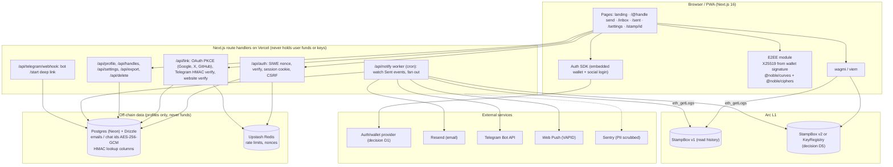

# Stamp v2: audit and plan

Status: **draft, waiting for approval** · Branch: `feat/v2-enhancements` · Baseline: `27bd68d` (StampBox v1 on Arc Testnet at `0x448C8cAB90a6aaCa0692cEBCDDCD06D3cA15d24B`, start block 65630121)

Baseline checks on this commit: `forge test` 70/70 passing, web typecheck and lint clean. `pnpm audit --prod` reports **5 transitive vulnerabilities (2 high, 3 moderate)**.

---

## 1. Audit of the current app

### 1.1 Confirmed: message and reply text are public plaintext on-chain

- `send(address to, string message)` emits `Sent(id, from, to, amount, message)`. The text is in the event log **and** in the transaction calldata. Both are public and permanent on every Arc node and explorer.
- `refund(id, reply)` emits `Settled(..., reply)`, so replies are public plaintext too.
- `bioOf[address]` is public plaintext in storage.
- `stamps[]` exposes `from`, `to`, `amount`, `sentAt` and `status` for every stamp. The social graph (who messages whom, how much, and whether they replied) is fully public.
- `/stamp/[id]` renders any stamp by sequential id, so the whole history is easy to enumerate. That isn't a leak (the chain is already public), but it shows how exposed the data is.

> Even v2 encryption cannot hide the *metadata*: sender, receiver, amount, timestamps and status stay public. Only the message and reply bodies can be hidden. Old v1 messages stay public forever.

### 1.2 Security and privacy

| # | Finding | Severity | Fix in |
|---|---|---|---|
| S1 | The **"Reply-to contact" field** on the send page (`send-page.tsx` `composeMessage`) puts the sender's email, X handle or Telegram link **into the public on-chain message**. The warning beside it is easy to miss. This is the biggest privacy leak in v1. | High (privacy) | P2: encrypted by default; until then, warn inline on that field |
| S2 | No security headers: no CSP, HSTS, `frame-ancestors`, Referrer-Policy or Permissions-Policy (`next.config.ts`). The app can be framed, which allows clickjacking of wallet prompts. | Medium | P2 |
| S3 | `pnpm audit`: `ws` (2 high/moderate: DoS, memory disclosure), `braces` (high: ReDoS), `uuid`, `decode-uri-component`. All come in transitively through WalletConnect, Reown and tooling. Mostly build-time or wallet-side, but they still need overrides. | Medium | P2 (pnpm `overrides` + Dependabot) |
| S4 | No Dependabot, CodeQL, gitleaks or `pnpm audit` in CI. Most dependencies use `^` ranges (lockfile only). | Medium | P2 |
| S5 | No SECURITY.md or PRIVACY.md. The disclosure policy lives only in CONTRIBUTING. | Low | P2 |
| S6 | Every visitor's browser queries the public Arc RPC directly. The RPC operator sees IP + wallet address + whose inbox is being read. | Low (privacy) | P5 (optional server-side read proxy + cache) |
| S7 | `themeInitScript` uses `dangerouslySetInnerHTML`. The content is a static constant, so it's safe, but a nonce-based CSP has to cover it. | Info | P2 |
| S8 | User text is rendered through React text nodes (`whitespace-pre-wrap`), so it's escaped correctly. URLs are not linkified, which is good for phishing but bad for UX. | Info (good) | P4 (safe-link previews) |
| S9 | Contract: CEI + `nonReentrant`, bounded payout gas, deferred payouts, invariant `balance == pending + totalOwed`, 100% coverage. No issues found. `batchKeep`/`batchRefund` loops are unbounded, but only the caller pays for them. | None | — |

### 1.3 UX

- **Crypto-only onboarding.** A new user needs a browser wallet, has to add the Arc network and must get USDC before doing anything. Social login doesn't exist. This is the biggest barrier to growth.
- **Identity is a hex address.** There are no handles, avatars or verified links, so a sender can't tell whether `0x8f3…` really is the person they want to reach. That makes impersonation easy.
- **No notifications.** A receiver only finds out about new stamps by opening `/inbox` (15s polling). Stamps can expire into reclaims unnoticed, which defeats the product.
- **The inbox is a flat list**, capped at the latest 200 stamps (`PAGE = 200n`). There are no threads, search, filters (beyond status tabs) or sorting, and no "load more". `reclaimed` has no tab of its own (it only shows under "all").
- **Keyboard:** `j/k/x/r/s/Esc` exist, but `?` help doesn't, and the shortcut tooltip is hidden on mobile (fine) and isn't announced to screen readers.
- **Sender view:** no countdown to reclaim eligibility on the list, and no earnings/history charts.
- **The demo inbox is unset** (`DEFAULT_DEMO_INBOX = ""`), so the landing page's "Try the demo inbox" CTA can't work without an env var.
- **Placeholders:** `SITE_URL` defaults to `stamp-arc.vercel.app` and `REPO_URL` to a GitHub repo that doesn't exist yet. The README hero GIF and video are missing.
- No PWA manifest, no i18n, no onboarding progress persistence.

### 1.4 Performance

- RainbowKit, wagmi and WalletConnect load in the **root layout**, so every page (including the static landing page) pays for the full wallet bundle.
- Message text needs `eth_getLogs` scans that start from an estimated block and fall back to a full scan from the deployment block. There's no persistent cache, so every visit rescans. This gets slower as the chain grows.
- One `getStamp` read per id (batched JSON-RPC, 200 ids max). Fine for now; it will need an indexer later.
- The OG image reads the chain at request time (`revalidate = 300`). Fine.

### 1.5 Accessibility (quick pass, full WCAG 2.2 AA audit in P4/P5)

Good: skip link, labelled inputs, `aria-live` regions, `aria-invalid`, `prefers-reduced-motion` respected in the send animation, visible focus rings.
Gaps: the whole inbox list is `aria-live="polite"` (too chatty: it announces every refetch). The inbox reply form's motion ignores reduced motion. No `?` shortcuts dialog. No automated axe checks.

### 1.6 Code health

- 10 shadcn components import `cn` from the npm package `cn` (shadcn's own package) while the rest of the app uses `@/lib/utils`. That's two class-merge implementations; standardise on one.
- `shadcn` (the CLI) is a runtime `dependency`; it should be a devDependency.
- No web unit or e2e tests at all (only contract tests).

---

## 2. Target architecture

Invariants that do not change:

- **Funds only move through the immutable contracts.** The server has no keys, signs nothing on-chain and is never a custodian.
- **The server never sees message plaintext.** Encryption and decryption happen only in the browser. The notification worker only sees "new stamp from X for $Y" (public metadata anyway).
- **Contracts:** no owner, no proxy, no fees; CEI + ReentrancyGuard + deferred payouts; fuzz + invariant tests; 100% coverage.

### E2EE design sketch (details in Phase 2)

1. The user signs a fixed, domain-separated message: `"Stamp encryption key v1\nchain:<id>\naddress:<addr>\n\nSigning this does not cost anything…"`.
2. `seed = HKDF-SHA256(signature, salt="stamp-e2ee", info="x25519-v1")`. That gives an X25519 keypair. The public key is published (D5); the private key is re-derived on demand and only cached in memory/session.
3. A message is encrypted with an ephemeral X25519 key + XChaCha20-Poly1305 for **two recipients** (receiver and sender), so the sender can still read their own Sent folder. Format: `0x01 | ephemeralPub | nonce | wrappedKey(receiver) | wrappedKey(sender) | ciphertext`.
4. Replies are encrypted the same way to the sender's key. If the sender has no key, the receiver gets the choice "reply publicly or don't include text".

**Caveat to decide on (D1/D4):** this needs **deterministic signatures**. That works for EOAs, including Privy/Dynamic/thirdweb embedded EOAs (RFC 6979). It does **not** work for passkey/WebAuthn smart accounts (e.g. Circle Modular Wallets), because those signatures are randomised. Those users would need a stored, wrapped key instead (e.g. a key encrypted under a passkey PRF), which is more complex.

---

## 3. Phase plan (each phase = green checks + report + one commit)

| Phase | Scope | Needs from you before starting |
|---|---|---|
| 0 | This audit + plan | Approval |
| 1 | Auth provider integration, SIWE sessions, linked accounts + verified badges, handles, settings page, Telegram login + bot | D1, D2, D3, D6, D7; keys in `.env.local` |
| 2 | E2EE module, Postgres schema + encryption at rest, security headers/CSP, zod + rate limits + Turnstile, supply-chain CI, PRIVACY/SECURITY docs, `/privacy`, `/security-review` | D4, D5, D8 |
| 3 | `StampBoxV2.sol` + tests + deploy script; v1/v2 side by side in the web app (only if D5 = v2) | D5, D9; you run the deploy |
| 4 | Mail-app inbox, realtime, dashboards, composer, public profile + widgets, notifications, PWA, i18n (en, hi), a11y, onboarding | D10, D11 |
| 5 | Vitest + Playwright + axe in CI, Lighthouse ≥ 90, Sentry, `/status`, docs, final reviews + report | D12 |

---

## 4. Decisions I need from you

### D1. Auth and embedded-wallet provider (blocks Phase 1)

What you asked for: Google, email OTP, X, Telegram, passkeys and external wallets; self-custodial with key export; works on Arc (custom EVM chain).

| | Circle User-Controlled / Modular Wallets | **Privy** (recommended) | Dynamic | thirdweb In-App Wallets |
|---|---|---|---|---|
| Google / email OTP | ✅ / ✅ | ✅ / ✅ | ✅ / ✅ | ✅ / ✅ |
| X (Twitter) | ❌ | ✅ | ✅ | ✅ |
| Telegram | ❌ | ✅ | ✅ | ✅ |
| Passkeys | ✅ (Modular: passkey smart account) | ✅ | ✅ | ✅ |
| External wallets | ❌ (separate) | ✅ (built-in, works with wagmi) | ✅ | ✅ |
| Custom EVM chain (Arc) | Native: Circle runs Arc | ✅ custom chain config | ✅ custom network | ✅ any EVM chain |
| Key export | User-controlled via PIN; Modular = passkey account, no raw key | ✅ | ✅ | ✅ |
| Linked accounts (verified badges) | ❌ | ✅ (Google, X, Telegram, GitHub…) | ✅ | Partial |
| Signature-derived E2EE key | ⚠️ Modular passkey signatures are non-deterministic | ✅ EOA | ✅ EOA | ✅ EOA |
| Gas sponsorship | ✅ (Modular + paymaster) | Via a paymaster integration | Via a paymaster integration | ✅ built-in |
| Pricing | Usage-based | Free tier, then per MAU | Free tier, then per MAU | Free tier, then usage-based |

**Recommendation: Privy.** It's the only option that covers every login method you listed plus **verified linked accounts** out of the box. That means Phase 1 doesn't need hand-rolled OAuth for Google, X or Telegram: we verify Privy's identity token server-side and read the linked accounts from it. Its embedded wallets are EOAs, so the signature-derived E2EE design works unchanged, and it plugs into wagmi so the existing hooks keep working.

Trade-offs: it's a third-party dependency for login (wallets stay exportable, so users aren't locked in), it costs money above the free tier, and gasless onboarding would need a separate paymaster. **I'll verify Arc support and current pricing live before you commit.** Circle is the most "native" fit for Arc, but it lacks X and Telegram login and complicates E2EE.

Follow-up question: if you pick Privy (or Dynamic/thirdweb), should **its** linked accounts drive the verified badges (less code, less to secure), or do you want **our own** OAuth/PKCE + Telegram HMAC flows as the prompt describes (more code, no provider lock-in for identity)? I recommend using the provider's, plus our own flow only for GitHub/website verification if the provider lacks them.

### D2. Database (blocks Phase 1)

**Recommendation: Neon Postgres + Drizzle ORM + drizzle-kit migrations**, with ownership checks in a single data-access layer (every query scoped by the session's address). Supabase is the alternative if you want Postgres RLS and a dashboard UI, but its auth would duplicate D1. Both have free tiers.

### D3. Rate limiting and bot protection

**Recommendation: Upstash Redis** (rate limits + SIWE nonce store) and **Cloudflare Turnstile** on sign-up. Both have free tiers and need accounts plus keys.

### D4. E2EE scheme

**Recommendation:** signature-derived X25519 + `@noble/curves`/`@noble/ciphers`, multi-recipient envelopes as sketched above, with a version byte. Please confirm: (a) encrypted messages are the **default** and "public message" is opt-in per inbox; (b) it's acceptable that users on passkey smart accounts can't use E2EE at first (if D1 = Circle Modular this becomes a real problem).

### D5. Where encrypted messages and keys live (biggest decision; drives Phase 3)

| Option | How | Pros | Cons |
|---|---|---|---|
| **A. No new contract** | Ciphertext goes base64-encoded into v1's `string message`; public keys are published off-chain (DB) with a signed proof | Ships fastest, no deploy, one inbox history | The 1,000-byte limit drops to ~300 plaintext bytes with two-recipient envelopes; keys depend on our DB being honest (the signature makes it verifiable, not available) |
| **B. KeyRegistry contract + v1** | A tiny immutable `KeyRegistry.setKey(bytes32)`; ciphertext in v1 `string` | Keys are on-chain and censorship-resistant; v1 unchanged | Same message-size limit as A; one extra tx (~45k gas, < $0.01) per user, once |
| **C. StampBox v2** (recommended) | New immutable contract: built-in key registry, `bytes` ciphertext with a larger limit, allowlist, price tiers | Proper fix: binary ciphertext, larger limit, free/cheaper tier for friends; one coherent v2 | New deploy and audit surface; the app must read v1 + v2 side by side; inboxes have to be reopened on v2 |

Recommendation: **C**, with the **EIP-712 "send on behalf" flow cut** (see D9).

### D6. Handles

**Recommendation:** handles live **off-chain** in Postgres, bound to an address by a SIWE signature, with a reserved/blocked list (brand names, `admin`, `support`, confusable Unicode → ASCII-only `[a-z0-9_]{3,20}`). URL form `/@handle`. ENS resolution only where it works on Arc. I'll check whether Arc has a name service. Alternative: on-chain handle registry in v2 (more trustless, but no moderation of impersonation).

### D7. Telegram bot

Please create a bot with **@BotFather** and put `TELEGRAM_BOT_TOKEN` + `TELEGRAM_BOT_USERNAME` in `.env.local`. The Login Widget also needs `/setdomain`, which **does not work on localhost**. For local testing we'll need a tunnel (e.g. `cloudflared`) or to test on a Vercel preview. Do you have a domain? See D10.

### D8. Analytics

Options: **none** (recommended to start, zero data collected), Plausible (paid, hosted) or Umami (self-host/cloud).

### D9. Contract v2 scope (Phase 3)

- **Allowlist (free/cheaper for friends) and per-sender price tiers:** recommended. Note that a free stamp has nothing to refund or keep. It's just a message with status "Free".
- **EIP-712 "send on behalf" (gasless): recommend cutting it.** Stamps are paid in native USDC via `msg.value`. A relayer would have to front the stamp *amount*, not just gas, so we'd need to pull Arc's ERC-20 USDC view with `permit`/`transferWithAuthorization` (6 decimals). That breaks the "native USDC only" design and adds a relayer that touches funds. Gasless onboarding is better served by a paymaster at the wallet layer (D1).
- Confirm: v2 starts at an empty state, and v1 stays read-only history in the UI (nobody can be forced to migrate pending stamps; they settle on v1 as usual).

### D10. Domain and hosting

`stamp.app` is almost certainly taken or premium. Which domain will you use? (It's needed for OAuth redirect URIs, the Telegram widget, email sending (Resend DNS) and OG links.) Vercel is assumed for hosting.

### D11. Notifications

Email via **Resend** (needs a verified sending domain), Telegram bot and Web Push (VAPID keys, generated locally). **New-stamp detection** needs a worker. Recommendation: Vercel Cron every minute calling `/api/notify`, which scans new `Sent` logs from the last processed block (stored in Postgres). Note that Vercel's Hobby plan limits cron frequency. The alternative is a third-party indexer webhook if one supports Arc.

### D12. Observability

**Sentry** (free tier) with `sendDefaultPii: false` + a `beforeSend` scrubber, or skip error tracking entirely.

---

## 5. Keys and accounts you'll need (nothing gets hard-coded; everything goes in `.env.local`)

Depends on the decisions above. With the recommendations:

| Variable | Service | Phase |
|---|---|---|
| `NEXT_PUBLIC_PRIVY_APP_ID`, `PRIVY_APP_SECRET` (or `PRIVY_VERIFICATION_KEY`) | Privy dashboard | 1 |
| `DATABASE_URL` | Neon | 1 |
| `SESSION_SECRET` (32+ random bytes) | generated locally | 1 |
| `TELEGRAM_BOT_TOKEN`, `TELEGRAM_BOT_USERNAME`, `TELEGRAM_WEBHOOK_SECRET` | BotFather / generated | 1 |
| `GITHUB_CLIENT_ID`, `GITHUB_CLIENT_SECRET` (only if the provider lacks GitHub linking) | GitHub OAuth app | 1 |
| `DATA_ENCRYPTION_KEYS` (versioned AES-256 keys), `LOOKUP_HMAC_KEY` | generated locally | 2 |
| `UPSTASH_REDIS_REST_URL`, `UPSTASH_REDIS_REST_TOKEN` | Upstash | 2 |
| `NEXT_PUBLIC_TURNSTILE_SITE_KEY`, `TURNSTILE_SECRET_KEY` | Cloudflare | 2 |
| `RESEND_API_KEY`, `EMAIL_FROM` | Resend | 4 |
| `NEXT_PUBLIC_VAPID_PUBLIC_KEY`, `VAPID_PRIVATE_KEY` | generated locally | 4 |
| `CRON_SECRET` | generated locally | 4 |
| `SENTRY_DSN`, `SENTRY_AUTH_TOKEN` | Sentry | 5 |

## 6. Risks and things worth knowing upfront

- **"No backend" becomes "a small backend."** The README's architecture story changes. The server holds profile data (encrypted) but never funds or message plaintext. I'll update the docs to say exactly that.
- **Scope.** Phases 1–5 add up to many weeks of work for a single team. I'll keep each phase shippable on its own. If you want an earlier public launch, Phases 2 (security headers, supply chain, E2EE) and 4's notifications give the most value per effort.
- **Old messages stay public.** Encryption only protects new messages.
- **X API access** for OAuth login can require a paid X developer tier. It's covered if Privy handles X login (D1).
- **Phase 3 deploy:** you run it with your keystore. I'll give you the exact PowerShell one-liners.
